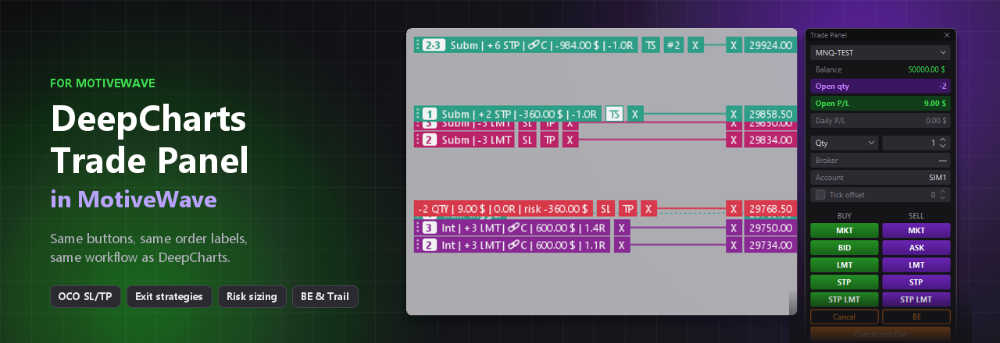

<p align="center">
  
</p>

<h1 align="center">DeepCharts Trade Panel in MotiveWave</h1>

<p align="center">
  <b>The DeepCharts trading panel, inside MotiveWave: same buttons, same order labels, same workflow.</b>
</p>

<p align="center">
  <a href="https://github.com/Dinamq/deepcharts-trade-panel-motivewave/releases/latest"></a>
  <a href="https://github.com/Dinamq/deepcharts-trade-panel-motivewave/releases"></a>
  <a href="LICENSE"></a>
  
  
  
</p>

<p align="center">
  <a href="https://github.com/Dinamq/deepcharts-trade-panel-motivewave/releases/latest/download/TradePanelDeepCharts.jar"></a>
</p>

<p align="center"><sub>
  Not affiliated with, endorsed by or connected to DeepCharts or MotiveWave. All trademarks belong to their owners.<br>
  Trading futures and other leveraged products involves substantial risk. Test on a simulated account first.
</sub></p>

---

## 🧭 Works like DeepCharts

If you trade with DeepCharts, you already know how to use it. The panel and the chart behave like the original DeepCharts trading panel:

- **Same panel:** BUY / SELL columns with MKT, BID / ASK, LMT, STP and STP LMT, Cancel, BE, Cancel and Flat, OCO Strategy with Mode, SL. / TP., BE. / Trail. and Server / Client.
- **Same order placement:** press LMT, STP or STP LMT and click the price on the chart. Esc or a right click cancels.
- **Same order labels:** `Subm | -3 LMT | ⚯C | 600.00 $` with the SL / TP / X buttons and the price tag on the axis. Drag a label to move the order; drag its SL or TP button to place an exit.
- **Same OCO logic:** internal (`Int`) exits are sent when the entry fills, and when one exit fills the other is cancelled. In Server mode the stop of an LMT entry goes to the broker with it.
- **Partial exits** like DeepCharts' Multi mode: exit strategies with several stops and targets, organised like MotiveWave's Exit Strategies.

## 🚀 Quick start

1. **Download** [`TradePanelDeepCharts.jar`](https://github.com/Dinamq/deepcharts-trade-panel-motivewave/releases/latest/download/TradePanelDeepCharts.jar).
2. **Copy** it to `%USERPROFILE%\MotiveWave Extensions` and restart MotiveWave.
3. **Add** the strategy **Trade Panel (DeepCharts)** to a chart (menu *MotiveWave Custom*) and press **Activate**. The panel appears; the **PANEL** button at the top right of the chart shows or hides it.

The language (English by default, or Spanish) and the label options are in the strategy settings.

## ✨ Features

<table>
<tr>
<td width="62%" valign="top">

| | |
|---|---|
| 🟢 **Entries** | MKT, BID / ASK with a tick offset, LMT, STP and STP LMT (emulated on the client). Click-to-place on the chart. |
| 🎯 **OCO exits** | Stop and target in ticks, points, money, R:R or % of the initial / current balance. |
| 🧩 **Exit strategies** | Named strategies with steps. Each step has its % of the quantity, a stop (Stop / Trail / MIT) and a target (Limit / MIT). Optional risk sizing and break even. |
| ⚖️ **Risk sizing** | **Risk** mode: mark the stop and the quantity comes from your risk. **Averaging** mode: add with a total-risk budget or a % of the locked-in profit. |
| 🛡️ **Breakeven & trailing** | BE button, auto BE, and a trailing stop with a draggable *Trail. Trigger* line. |
| 🔗 **Order management** | Link pending orders, turn loose exits into an OCO, Cancel all, Cancel and Flat. |
| 🏷️ **Chart labels** | Entry numbers shared with their SL / TP. Exits at the same price are merged into one line and split again with #N. Optional R multiple and risk in money, %, ticks or points. |
| 🚨 **Errors on the chart** | Orders not sent and broker rejections appear for a few seconds in a red box. |
| 🌐 **Languages** | English and Spanish. |

</td>
<td width="38%" valign="top" align="center">

</td>
</tr>
</table>

### 🏷️ Order labels on the chart

<p align="center"></p>

### 🧩 Exit strategies

<p align="center"></p>

## 🛠️ Building from source

Requirements:
- Windows with MotiveWave in `C:\Program Files (x86)\MotiveWave`. The SDK and JavaFX jars are taken from there.
- PowerShell. `build.ps1` downloads a portable JDK 26 the first time if it can't find one.

```powershell
.\build.ps1             # compile + engine tests + jar + install into %USERPROFILE%\MotiveWave Extensions
.\build.ps1 -NoTest     # skip the tests
.\build.ps1 -NoInstall  # only build the jar
```

The tests (`test/java/com/tradepanel/EngineTest.java`, 300+ checks) run the order engine against a simulated broker, without MotiveWave.

<details>
<summary><b>Project layout</b></summary>

| File | What it does |
|---|---|
| `TradePanelStrategy.java` | Link with the MotiveWave SDK: settings, order events, mouse, drawing |
| `TradeEngine.java` | Order engine (single thread): entries, OCO exits, exit strategies, BE, trailing, chart lines |
| `PanelWindow.java` | The floating JavaFX panel and the exit strategy editor |
| `LineFigure.java` / `LineModel.java` | Order labels on the chart |
| `Config.java` | Panel values and exit strategies, saved in the user preferences |
| `T.java` | English / Spanish texts |

</details>

## ⚠️ Limitations

- The MotiveWave SDK has no native stop-limit, MIT or server-side OCO orders. STP LMT entries, MIT targets, trailing and the OCO between stop and target are managed by the panel, so MotiveWave must stay open.
- Tested offline against a simulated broker. Check it on a simulated account with your broker before trading live.

## 👤 Author

Made by **Dinamq** (Gonzaliito). Released under the [MIT License](LICENSE).

---

<details>
<summary><b>🇪🇸 Español</b></summary>

**DeepCharts Trade Panel in MotiveWave**: el panel de trading de DeepCharts dentro de MotiveWave, con los mismos botones, las mismas etiquetas de órdenes y la misma forma de trabajar.

1. Descarga [`TradePanelDeepCharts.jar`](https://github.com/Dinamq/deepcharts-trade-panel-motivewave/releases/latest/download/TradePanelDeepCharts.jar).
2. Cópialo en `%USERPROFILE%\MotiveWave Extensions` y reinicia MotiveWave.
3. Añade la estrategia **Trade Panel (DeepCharts)** a un gráfico y pulsa **Activate**.

El idioma se cambia en los ajustes de la estrategia (*Idioma / Language*). No está afiliado a DeepCharts ni a MotiveWave. Operar con productos apalancados conlleva un riesgo importante: pruébalo antes en una cuenta simulada.

Autor: **Dinamq** (Gonzaliito).

</details>
