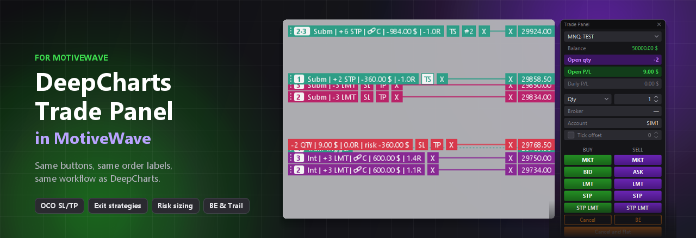
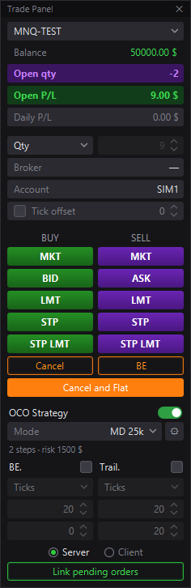
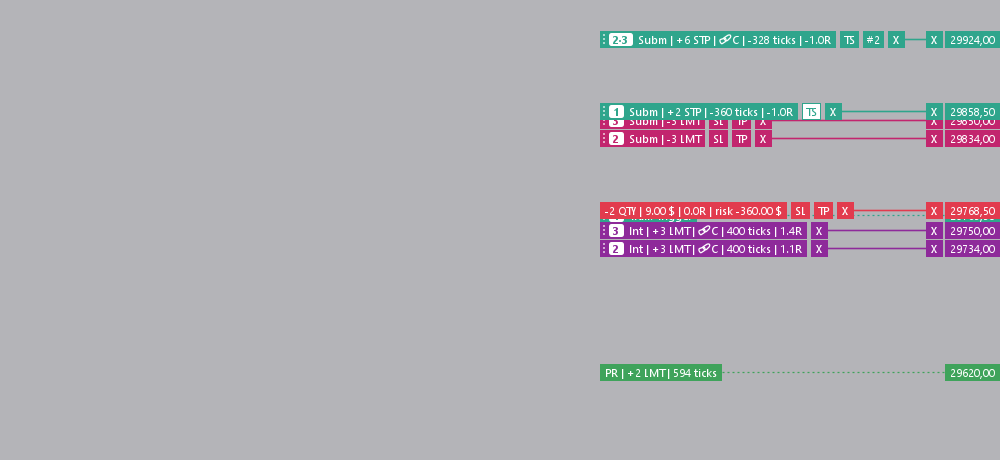
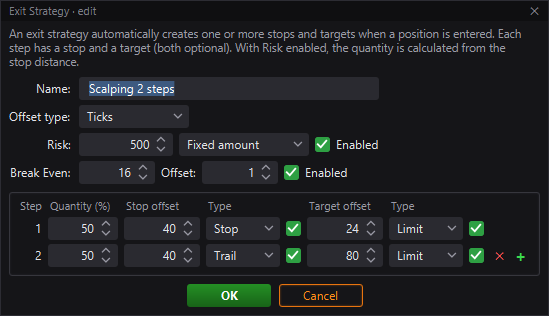

<p align="center">
  
</p>

<h1 align="center">DeepCharts Trade Panel in MotiveWave</h1>

<p align="center">
  <b>The DeepCharts trading panel, inside MotiveWave: same buttons, same order labels, same workflow.</b>
</p>

<p align="center">
  <a href="https://github.com/Dinamq/deepcharts-trade-panel-motivewave/releases/latest"></a>
  <a href="https://github.com/Dinamq/deepcharts-trade-panel-motivewave/releases"></a>
  <a href="LICENSE"></a>
  
  
  
</p>

<p align="center">
  <a href="https://github.com/Dinamq/deepcharts-trade-panel-motivewave/releases/latest/download/TradePanelDeepCharts.jar"></a>
  &nbsp;
  <a href="https://discord.gg/VeEJzJRCRb"></a>
</p>

<p align="center">
  💬 <b>Questions, ideas or bugs?</b> Join the <a href="https://discord.gg/VeEJzJRCRb"><b>TRADERPATH community on Discord</b></a>: support, updates and other traders using the panel.
</p>

<p align="center"><sub>
  Not affiliated with, endorsed by or connected to DeepCharts or MotiveWave. All trademarks belong to their owners.<br>
  Trading futures and other leveraged products involves substantial risk. Test on a simulated account first.
</sub></p>

---

## 🆕 What's new in v1.0.3

Bug fixes for order placement and the daily P/L:

- 🖱️ **No more lost clicks when placing an order.** Sometimes LMT / STP was pressed, the chart was clicked and nothing was placed, and only removing and re-adding the strategy seemed to help. The causes are fixed:
  - the label of the dotted preview line, which follows the mouse, was taking the click;
  - clicking on the label of an order already on the chart did nothing: now it places the new order at that price (its X / SL / TP / #N buttons still work as before);
  - a chart inside tabs or a split screen could ignore the click, and a chart in a hidden tab could take it from the visible one;
  - the click was lost if the mouse moved a pixel or two: now up to 6 px is accepted.
- 📅 **Daily P/L that matches your broker.** With some brokers (Rithmic, for example) MotiveWave stores each fill with a P/L of 0, so the daily P/L still went back to 0 after re-activating. It is now rebuilt from the price and quantity of today's fills, per account and instrument, gross (without commissions). A position opened yesterday and closed today counts today.
- 🏷️ The MotiveWave log now says why a click was ignored while an order was armed, to find any remaining case.

<details>
<summary><b>What's new in v1.0.2</b></summary>

- 🔀 **Switch instruments from the panel:** the instrument dropdown now works. Activate the Trade Panel once on each instrument's chart and switch between them from the dropdown, or just click on a chart: the panel follows it, as in DeepCharts.
- 🎯 **Exact risk in Risk mode:** the stop snaps to the price where the calculated contracts risk exactly your SL amount (for example 1500 $ instead of 1360 $). It can be turned off in the settings.
- 📅 **Daily P/L that survives a restart:** it comes from the account's trade history for today, so it no longer goes back to 0 when you deactivate and activate the strategy.
- ✂️ **Easier splitting of merged exits:** click a number of the badge (`2•3•1`) to choose which exit the #N button takes out. Dropping it back on the group merges it again.
- 🛡️ **BE button offset, easier to find:** the setting that places the BE a few ticks in profit is now called *BE button: ticks in favor from the entry (BE offset)* (settings → Orders).
- 🖱️ **Dropdowns react on the first click,** even when another menu is open.
- 💾 **Qty / Risk / Averaging is remembered** when you change the mode.
- 🔵 **Split-screen charts** of the same instrument show up as mirrors (blue dot). A chart activated on another account says so on the chart.
- 🏷️ **Version** shown in the strategy settings (*About*).

</details>

## 🧭 Works like DeepCharts

If you trade with DeepCharts, you already know how to use it. The panel and the chart behave like the original DeepCharts trading panel:

- **Same panel:** BUY / SELL columns with MKT, BID / ASK, LMT, STP and STP LMT, Cancel, BE, Cancel and Flat, OCO Strategy with Mode, SL. / TP., BE. / Trail. and Server / Client.
- **Same order placement:** press LMT, STP or STP LMT and click the price on the chart. Esc or a right click cancels.
- **Same order labels:** `Subm | -3 LMT | ⚯C | 600.00 $` with the SL / TP / X buttons and the price tag on the axis. Drag a label to move the order; drag its SL or TP button to place an exit.
- **Same OCO logic:** internal (`Int`) exits are sent when the entry fills, and when one exit fills the other is cancelled. In Server mode the stop of an LMT entry goes to the broker with it.
- **Partial exits** like DeepCharts' Multi mode: exit strategies with several stops and targets, organised like MotiveWave's Exit Strategies.

## 🚀 Quick start

1. **Download** [`TradePanelDeepCharts.jar`](https://github.com/Dinamq/deepcharts-trade-panel-motivewave/releases/latest/download/TradePanelDeepCharts.jar).
2. **Copy** it to `%USERPROFILE%\MotiveWave Extensions` and restart MotiveWave.
3. **Add** the strategy **Trade Panel (DeepCharts)** to a chart (menu *MotiveWave Custom*) and press **Activate**. The panel appears; the **DEEPCHARTS** button at the bottom right of the chart shows or hides it.

The language (English by default, or Spanish) and the label options are in the strategy settings.

### 🪟 Several charts of the same instrument

Add the Trade Panel to every chart where you want to see and manage your orders, but press **Activate** on **one** of them only.

- The chart you activated places and manages the orders: its **DEEPCHARTS** button shows a 🟢 green dot.
- The other charts of the same instrument become mirrors (🔵 blue dot). They show the same order lines, and you can place, drag and cancel orders from them, all through the activated chart.
- This also works with Cross Trade: for example, a chart of NQ that trades MNQ.
- Charts activated on different accounts work independently.
- If the panel title shows **"inactive: press Activate"**, the strategy is not active on any chart.

### 🔀 Several instruments

Activate the Trade Panel once on a chart of each instrument (for example NQ and ES). There is one panel window for all of them:

- **Click on a chart** and the panel switches to that instrument, as in DeepCharts.
- Or pick the instrument in the panel's **instrument dropdown**.
- Deactivating one instrument switches the panel to another one that is still active.
- MotiveWave doesn't let an extension change a chart's instrument. If you change the symbol of a chart where the Trade Panel is active, it keeps trading the previous one and shows a notice: press **Deactivate** and **Activate** to trade the new one.

### 🔁 Copy trading

MotiveWave rejects orders from strategies on *Trade Copier* accounts. Instead, activate the Trade Panel on your **lead account** and copy it to the other accounts with an external copier, such as your broker's or Rithmic's.

## ✨ Features

<table>
<tr>
<td width="62%" valign="top">

| | |
|---|---|
| 🟢 **Entries** | MKT, BID / ASK with a tick offset, LMT, STP and STP LMT (emulated on the client). Click-to-place on the chart. |
| 🎯 **OCO exits** | Stop and target in ticks, points, money, R:R or % of the initial / current balance. |
| 🧩 **Exit strategies** | Named strategies with steps. Each step has its % of the quantity, a stop (Stop / Trail / MIT) and a target (Limit / MIT). Optional risk sizing and break even. |
| ⚖️ **Risk sizing** | **Risk** mode: mark the stop and the quantity comes from your risk. The stop then snaps to the price where exactly that amount is at risk (optional). **Averaging** mode: add with a total-risk budget or a % of the locked-in profit. |
| 🛡️ **Breakeven & trailing** | BE button, auto BE, and a trailing stop with a draggable *Trail. Trigger* line. |
| 🔗 **Order management** | Link pending orders, turn loose exits into an OCO, Cancel all, Cancel and Flat. |
| 🔀 **Several instruments** | One panel for all your charts: it follows the chart you click, or pick the instrument in its dropdown. |
| 📅 **Daily P/L** | Today's realized P/L for the account and instrument, rebuilt from MotiveWave's trade history (gross, without commissions). |
| 🏷️ **Chart labels** | Entry numbers shared with their SL / TP. Exits at the same price are merged into one line and split again with #N. Optional R multiple and risk in money, %, ticks or points. |
| 🚨 **Errors on the chart** | Orders not sent and broker rejections appear for a few seconds in a red box. |
| 🌐 **Languages** | English and Spanish. |

</td>
<td width="38%" valign="top" align="center">

</td>
</tr>
</table>

### 🏷️ Order labels on the chart

<p align="center"></p>

### 🧩 Exit strategies

<p align="center"></p>

## 🛠️ Building from source

Requirements:
- Windows with MotiveWave in `C:\Program Files (x86)\MotiveWave`. The SDK and JavaFX jars are taken from there.
- PowerShell. `build.ps1` downloads a portable JDK 26 the first time if it can't find one.

```powershell
.\build.ps1             # compile + engine tests + jar + install into %USERPROFILE%\MotiveWave Extensions
.\build.ps1 -NoTest     # skip the tests
.\build.ps1 -NoInstall  # only build the jar
```

The tests (`test/java/com/tradepanel/EngineTest.java`, 370+ checks) run the order engine against a simulated broker, without MotiveWave.

<details>
<summary><b>Project layout</b></summary>

| File | What it does |
|---|---|
| `TradePanelStrategy.java` | Link with the MotiveWave SDK: settings, order events, mouse, drawing |
| `TradeEngine.java` | Order engine (single thread): entries, OCO exits, exit strategies, BE, trailing, chart lines |
| `PanelWindow.java` | The floating JavaFX panel and the exit strategy editor |
| `LineFigure.java` / `LineModel.java` | Order labels on the chart |
| `Config.java` | Panel values and exit strategies, saved in the user preferences |
| `T.java` | English / Spanish texts |

</details>

## ⚠️ Limitations

- The MotiveWave SDK has no native stop-limit, MIT or server-side OCO orders. STP LMT entries, MIT targets, trailing and the OCO between stop and target are managed by the panel, so MotiveWave must stay open.
- MotiveWave keeps the Trade Panel on your charts after a restart, but it never activates strategies automatically: press **Activate** again.
- MotiveWave doesn't let an extension change a chart's instrument: the dropdown switches between the charts where the Trade Panel is active.
- When the strategy is deactivated or switched to another account, MotiveWave cancels its working orders. The position is closed according to the strategy's *Close on Deactivate* option.
- Tested offline against a simulated broker. Check it on a simulated account with your broker before trading live.

## 💬 Community

Support, new versions and feedback in the **TRADERPATH** Discord:

<a href="https://discord.gg/VeEJzJRCRb"></a>

## 👤 Author

Made by **Dinamq** (Gonzaliito). Released under the [MIT License](LICENSE).

---

<details>
<summary><b>🇪🇸 Español</b></summary>

**DeepCharts Trade Panel in MotiveWave**: el panel de trading de DeepCharts dentro de MotiveWave, con los mismos botones, las mismas etiquetas de órdenes y la misma forma de trabajar.

1. Descarga [`TradePanelDeepCharts.jar`](https://github.com/Dinamq/deepcharts-trade-panel-motivewave/releases/latest/download/TradePanelDeepCharts.jar).
2. Cópialo en `%USERPROFILE%\MotiveWave Extensions` y reinicia MotiveWave.
3. Añade la estrategia **Trade Panel (DeepCharts)** a un gráfico y pulsa **Activate**.

Novedades de la v1.0.3: ya no se pierden clics al colocar una orden (la etiqueta de la vista previa se quedaba con el clic, un clic sobre la etiqueta de otra orden no colocaba nada, los gráficos en pestañas o con la pantalla dividida podían ignorarlo y bastaba con mover un poco el ratón), y el P/L diario se calcula con el precio y la cantidad de las ejecuciones del día, así que cuadra con el del bróker (sin comisiones) y no vuelve a 0 al reactivar.

Novedades de la v1.0.2: el desplegable del activo cambia entre los gráficos con el Trade Panel activado (y el panel sigue al gráfico en el que pulsas), el modo Risk pone el stop donde se arriesga justo el importe, el P/L diario sale del historial de la cuenta y no se pierde al reactivar, se elige qué salida separar pulsando su número, el ajuste para desplazar el BE unos ticks a favor tiene un nombre más claro y los desplegables responden al primer clic.

El idioma se cambia en los ajustes de la estrategia (*Idioma / Language*). No está afiliado a DeepCharts ni a MotiveWave. Operar con productos apalancados conlleva un riesgo importante: pruébalo antes en una cuenta simulada.

Comunidad en Discord (soporte, novedades y otros traders): [TRADERPATH](https://discord.gg/VeEJzJRCRb).

Autor: **Dinamq** (Gonzaliito).

</details>
