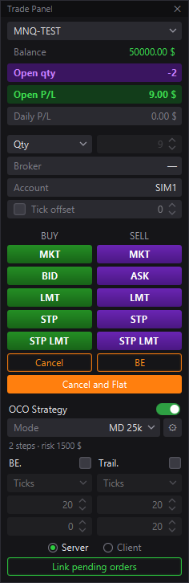
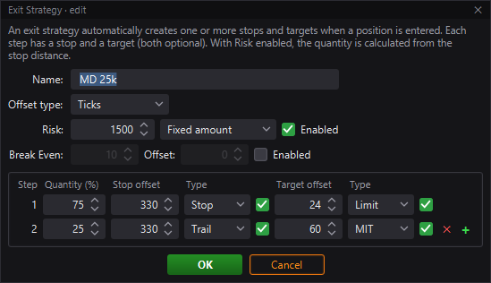
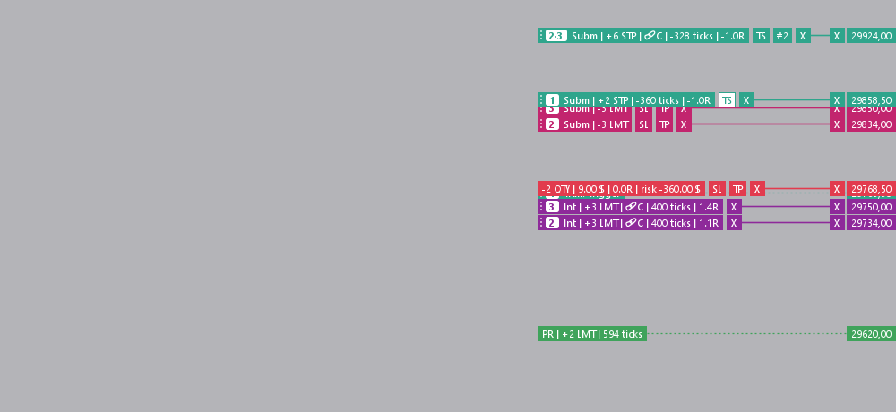

# MotiveWave Trade Panel

A floating trading panel and on-chart order management for [MotiveWave](https://www.motivewave.com/), built with the MotiveWave SDK. Its layout and workflow are modelled on the trading panel of DeepCharts.

> **Not affiliated** with MotiveWave or DeepCharts. Trading futures and other leveraged products involves substantial risk. This software is provided as is, without warranty (see [LICENSE](LICENSE)). Test it on a simulated account first.

The interface is available in **English** (default) and **Spanish** (*Idioma / Language* in the strategy settings).



## Features

**Entries**
- MKT, BID/ASK (with an optional tick offset), LMT, STP and STP LMT. STP LMT is emulated on the client, because the SDK has no stop-limit order.
- Price-based orders: press the button, then click the price on the chart. Esc, a right click or a click on the orange banner cancels the placement.
- Quantity modes:
  - **Qty**: fixed quantity.
  - **Risk**: mark the stop on the chart; the quantity comes from the SL risk (money or % of balance).
  - **Averaging**: add to a position with a total-risk budget (against) or a % of the profit the stops lock in (in favor).

**Exits (OCO)**
- **SL/TP mode**: stop and target in ticks, points, money, R:R or % of the initial or current balance.
- **Exit strategies**, structured like MotiveWave's Exit Strategies:
  - named strategies, with offsets in ticks or % of price;
  - optional risk-based sizing (fixed amount or % of account) and break even;
  - a table of steps, each with its % of the quantity, a stop (Stop / Trail / MIT) and a target (Limit / MIT).
- **Server / Client**: in Server mode the stop of an LMT entry is sent to the broker together with it.
- Auto breakeven, trailing stop with a draggable *Trail. Trigger* line, and a breakeven button.

**On the chart**
- DeepCharts-style order labels with the quantity, the money at the order's price and SL / TP / TS / X buttons. Drag a label to move an order; drag the SL or TP button to place an exit.
- Each entry gets a number (1, 2, 3…) shared with its SL and TP.
- Exits at the same price are merged into one line, either by dropping one on another (snaps within a few pixels) or by placing them there. Drag the line's #N button to split them again, last one in first out.
- Configurable labels:
  - the position can show its R multiple and its risk;
  - SL/TP lines can show their amount in money, %, ticks or points, and their R.
- Errors (orders not sent, broker rejections…) show for a few seconds in a red box at the top of the chart.
- Link pending orders (one fills, the others are cancelled), turn loose exit orders into an OCO, Cancel all, Cancel and Flat.





## Installation

1. Download `TradePanelDeepCharts.jar` from the [Releases](../../releases) page, or build it yourself (see below).
2. Copy it to `%USERPROFILE%\MotiveWave Extensions` and restart MotiveWave.
3. Add the strategy **Trade Panel (DeepCharts)** to a chart (menu *MotiveWave Custom*) and press **Activate**. The panel appears; the **PANEL** button at the top right of the chart shows or hides it.

## Building

Requirements:
- Windows with MotiveWave installed in `C:\Program Files (x86)\MotiveWave`. The SDK and JavaFX jars are taken from there.
- PowerShell. `build.ps1` downloads a portable JDK 26 the first time if it can't find one.

```powershell
.\build.ps1             # compile + engine tests + jar + install into %USERPROFILE%\MotiveWave Extensions
.\build.ps1 -NoTest     # skip the tests
.\build.ps1 -NoInstall  # only build the jar
```

The tests (`test/java/com/tradepanel/EngineTest.java`) run the order engine against a simulated broker, with no MotiveWave needed.

## Project layout

| File | What it does |
|---|---|
| `TradePanelStrategy.java` | Link with the MotiveWave SDK: settings, order events, mouse, drawing |
| `TradeEngine.java` | Order engine (single thread): entries, OCO exits, exit strategies, BE, trailing, chart lines |
| `PanelWindow.java` | The floating JavaFX panel and the exit strategy editor |
| `LineFigure.java` / `LineModel.java` | Order labels on the chart |
| `Config.java` | Panel values and exit strategies, saved in the user preferences |
| `T.java` | English / Spanish texts |

## Author

Made by **Dinamq** (Gonzaliito).

## Limitations

- The SDK has no native stop-limit, MIT or server-side OCO orders. STP LMT entries, MIT targets, trailing and the OCO between stop and target are managed by the panel, so MotiveWave must stay open.
- Tested offline with a simulated broker. Check it on a simulated account with your broker before trading live.

---

### Español

Panel de trading flotante y gestión de órdenes desde el gráfico para MotiveWave, al estilo del panel de DeepCharts. El idioma se elige en los ajustes de la estrategia (*Idioma / Language*). Para instalarlo, copia `TradePanelDeepCharts.jar` en `%USERPROFILE%\MotiveWave Extensions`, reinicia MotiveWave y añade la estrategia **Trade Panel (DeepCharts)** a un gráfico. Operar con productos apalancados conlleva un riesgo importante: pruébalo antes en una cuenta simulada.

Autor: **Dinamq** (Gonzaliito).
